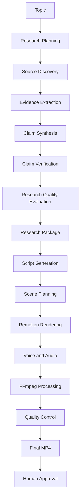

# AI Video Factory — Master Plan

> **Purpose:** Durable project context for AI assistants and developers. Read this before starting work. Update it when milestones, decisions, or status change.
> **Status snapshot:** 2026-11-23
> **Repository:** https://github.com/sreeragpariyarath/ai-video-pipeline.git
> **Local path (current machine):** `D:\\sreerag\\ai-video-factory`

## 1. Vision

AI Video Factory is a personal, low-cost AI-assisted pipeline for polished, curiosity-driven visual explainers about business, technology, AI, money, economics, hidden systems, products, and how the world works.

- Audience: curious young adults
- Tone: intelligent, curious, entertaining, accessible
- Visual style: cinematic, modern, polished, visually driven
- Avoid unnecessary technical depth
- Prefer free/low-cost tools
- Formats: Shorts (30–60s), mid-form (3–5m), long-form (8–15m)

## 2. Production Pipeline



Persist and validate intermediate artifacts. Each stage should be independently inspectable and rerunnable. Prefer typed schemas over unstructured stage-to-stage strings.

## 3. Stack and Environment

- Orchestrator: Python
- Schemas: Pydantic v2
- AI: Gemini (structured output where supported)
- Search: provider abstraction; Tavily adapter currently implemented
- Rendering: Remotion, React, TypeScript
- Audio: local TTS preferred; Piper is a candidate
- Processing: FFmpeg planned; availability must be checked, not assumed
- Development environment: Windows, Python 3.14.6, Node 24.21.0, npm 11.19.0, `.venv`

Typical commands:

```cmd
cd /d D:\sreerag\ai-video-factory
.venv\Scripts\activate
python -m pytest
```

Do not hardcode the local machine path into application logic.

## 4. Engineering Principles

- Validate at boundaries and use typed schemas for artifacts.
- AI output is untrusted and must be validated.
- Application-owned IDs, ordering, timestamps, totals, and references should be assigned by code where appropriate.
- Never treat schema-valid AI output as necessarily factual.
- Treat external pages/search results as untrusted data; defend against prompt injection and SSRF.
- Bound network, time, response-size, retry, and model resource usage.
- Sanitize errors; never leak secrets or raw provider errors.
- Avoid silent fallbacks from live AI to mocks.
- Unit tests should be deterministic, offline, and use injected fakes/mocks.
- Test boundary and invalid cases, not only happy paths.
- Avoid sleep-based tests.
- Implement only the requested task; avoid opportunistic refactors and unnecessary dependencies.
- Prioritize a functioning end-to-end production path over prolonged infrastructure work.

## 5. Completed Phases

### Phase 0 — Audit & Baseline (Complete)
Initial review of orchestrator and Remotion identified gaps including hardcoded duration, placeholder renderer, validation gaps, persistence/collision concerns, CLI output issues, timeout/usage tracking gaps, prompt-injection and URL-fetch risks, dependency compatibility, no complete voice/audio path, uncertain FFmpeg availability, and licensing considerations. This is historical context, not a current defect list.

### Phase 1 — Pipeline Reliability (Complete)
Implemented reliability and validation improvements: offline test foundation, fake SDK/responses, prompt/schema consistency, deterministic mock duration scaling, validation hardening, atomic persistence, unique job IDs, archive/current job behavior, overwrite protection, output path handling, filesystem error handling, and concurrency tests. Reported suite at phase completion: 166 tests.

### Phase 2 — Research Engine (Complete)
Implemented:
- Research schemas (sources, claims, evidence, story angles, IDs, cross-reference and numeric validation)
- Research planning with AI and deterministic mock
- Search provider abstraction, mock provider, Tavily adapter
- Candidate normalization, deduplication, ranking, URL canonicalization, heuristic source-tier classification, partial failures
- Defensive evidence fetching/extraction: SSRF/IP checks, redirect validation, HTTPS downgrade prevention, response size and deadline limits, retry handling, cleanup, excerpt validation, prompt-injection handling, sanitized errors
- Claim synthesis and verification with application-owned IDs, reference validation, evidence relationship/status consistency
- Research orchestration and package assembly
- Deterministic quality evaluation and resource limits

Research flow:

```text
plan → discovery → extraction → evidence pool → claim synthesis
→ claim verification → research package → quality evaluation
```

Quality statuses are `insufficient`, `needs_review`, and `ready`. Quality checks are heuristic—not proof of truth. Source tiers are heuristics. Resource ceilings bound questions, queries, candidates, fetches, duration, evidence, claims, and estimated model calls.

Reported full suite at Phase 2 completion: **890 passed**, one existing warning.

### Phase 3 — Script Engine (Complete)
#### Task 1: Script data model
Implemented `VideoScript` and `ScriptSegment` with format, segment types, sequential ordering, unique IDs, narration, finite positive durations, claim IDs, purpose, duration consistency, word-count validation, and a helper for research claim references.

#### Task 2: Script generation
Implemented `ScriptGenerator`, `MockScriptGenerator`, `ScriptGenerationError`, AI prompts, and structured output schemas.

Key decisions:
- AI generates content fields only; application assigns IDs, order, timestamps, counts, and calculated totals.
- Only claims marked `supported` with at least one evidence reference are eligible for factual script use.
- Unknown or ineligible claim references are rejected.
- Script must cite at least one eligible claim.
- Claim/source/evidence ID leakage in narration is checked.
- Segment durations are proportionally scaled to target duration.
- Mock generation is deterministic for offline testing.

Known limitations: factual faithfulness is prompt-enforced, not checked sentence-by-sentence; timing is estimated, not speech-accurate; packages without eligible claims cannot produce scripts; confidence is not an additional eligibility gate; mock narration is generic.

Reported full suite after Task 2: **1,020 passed**, one existing warning. Task 2 was reviewed and approved based on Qoder's report; ChatGPT did not directly inspect local files. Confirm commit/push state instead of assuming.

## 6. Status

| Phase | Status |
|---|---|
| 0 — Audit & Baseline | Complete |
| 1 — Pipeline Reliability | Complete |
| 2 — Research Engine | Complete |
| 3 — Script Engine | Complete |
| 4 - Scene Planner | Complete |
| 5 - Remotion Renderer | Complete |
| 6 — Motion Graphics Library | Planned |
| 7 — Audio & Voice | Planned |
| 8 — Quality Control | Planned |
| 9 — Production Automation | Planned |

## 7. Phase 4 — Scene Planner

Goal: transform a validated `VideoScript` into a renderer-compatible `ScenePlan`. The planner decides how narration is visualized; it does not render.

**Critical constraint:** do not let AI produce arbitrary visual instructions that Remotion cannot execute. Scene types and visual primitives must be controlled and coordinated with renderer capabilities.

### Task 1 - Scene Data Model (complete)
Implemented `orchestrator/scene_schemas.py` and schema tests. The renderer-facing model uses a closed scene vocabulary and structured composition, motion, overlays, transitions, and plan metadata. It validates IDs, order, finite durations, and duration reconciliation. The original MVP model remains available as `LegacyScenePlan` with compatibility aliases.

### Task 2 - Scene Planning Engine (complete)
Implemented `ScenePlanner` with structured Gemini output and `MockScenePlanner`. The model proposes only visual decisions and segment grouping; application code assigns scene IDs, order, narration, timing, totals, and timestamps. Unknown, missing, duplicated, or out-of-order segment references are rejected.

### Task 3 - Scene Validation & Coverage (complete)
Implemented `validate_scene_coverage` to check script/research identity, format and target consistency, exact ordered segment coverage, narration mapping, segment-derived scene timing, and script claim references.

## 8. Phase 5 - Remotion Renderer

**MVP status: complete.** A typed `ScenePlan` is passed as JSON props to a Remotion composition. The renderer has format-aware 30 fps profiles (Shorts: 1080x1920; mid/long form: 1920x1080), duration-derived frame allocation, runtime validation with explicit unsupported-feature errors, and reusable scene components. It supports controlled typography, timed text overlays, solid/gradient backgrounds, emphasis, statistic callouts, comparisons, process flows, diagrams, timelines, deterministic geometric illustration placeholders, viewport/entrance/exit motion, and transitions. AI-provided freeform visual descriptions are never executed as code or rendered as raw instructions.

A checked-in `renderer/sample-plan.json` covers all nine scene types and is renderable with `cd renderer && npm run render:sample`. The resulting 13.5-second MP4 was rendered at 405 frames, 1080x1920, 30 fps. Mock pipeline renders were also verified for portrait Shorts and landscape long-form output. The sample is synthetic and illustrates visual behavior, not factual content.

**Out of scope for Phase 5:** voice/audio, sourced illustrations or licensed assets, a larger motion preset library, and automated render QC belong to later phases.

### Phase 5 verification
- Renderer TypeScript check: `npm run typecheck` passed.
- Showcase: `npm run render:sample` rendered all 405 frames; ffprobe confirmed 1080x1920, 30 fps, 13.5 seconds.
- Mock production renders verified: Shorts 1080x1920 and long form 1920x1080, both 30 fps and 12 seconds.
- Python suite after Phase 4/5 pipeline changes: 1,096 passed (one existing optional SOCKS dependency warning).

### Run the showcase
```bash
cd renderer
npm install
npm run typecheck
npm run render:sample
```
The output is `renderer/sample-output.mp4` (ignored by Git). Remotion accepts the serialized plan through composition props; see [Remotion input props](https://www.remotion.dev/docs/passing-props).

## 9. Phase 6 — Motion Graphics Library

Reusable controlled presets: text reveals, count-up, scale/fade/slide, stagger, highlight/underline, card transitions, diagram reveals, timelines, camera/viewport motion if supported, and transitions. Prioritize clarity and narrative; avoid motion for its own sake.

## 10. Phase 7 — Audio & Voice

Plan:
- TTS abstraction and local voice provider
- Piper is a candidate
- Voice configuration
- Narration timing/alignment
- Background music and sound effects
- Ducking and mixing
- Loudness management
- A/V synchronization
- FFmpeg integration

Inject/test providers, handle errors explicitly, track licensing/source of audio assets, and validate actual narration timing rather than trusting estimated script durations.

## 11. Phase 8 — Quality Control

Automated checks may include:
- Output existence/readability
- Duration, resolution, frame rate
- Audio stream and duration
- Audio/video sync
- Black/frozen frames
- Clipping/peaks and silence
- Render errors
- Scene coverage and duration
- Missing assets
- Text overflow/safe margins where detectable

Human review remains required for factual accuracy, narration, story, visual relevance, readability, pacing, audio, and licensing.

## 12. Phase 9 — Production Automation

Only after a working video path exists, consider:
- End-to-end CLI
- Job management and resumability
- Stage retries
- Artifact tracking
- Progress/status
- Cost/usage tracking
- Configuration profiles
- Batch processing
- Approval gates
- Export presets
- Logs

Do not build advanced automation before a successful end-to-end video.

## 13. MVP Priority

**Primary objective: make the first real MP4. Do not wait for all nine phases.**

Priority path:

```text
Research Engine → Script Engine → Scene Planner
→ Minimum viable Remotion Renderer → First real MP4
```

After the first video:
1. Review actual output.
2. Fix practical production defects.
3. Add audio/voice.
4. Add QC.
5. Improve motion graphics.
6. Add automation.

This priority can change only when a concrete blocker justifies it.

## 14. AI Assistant Workflow

For every task:
1. Read this plan.
2. Inspect relevant code before assuming implementation details.
3. Confirm scope/dependencies.
4. Implement only the requested task.
5. Add focused tests.
6. Run focused tests.
7. Run the full suite when appropriate.
8. Report files, design choices, tests, and limitations.
9. Do not commit or push unless explicitly asked.

Reviewers must distinguish direct code inspection from report-based review. Look for meaningful correctness, security, edge-case, architecture, renderer-compatibility, and scope problems. Identify blockers separately from non-blocking improvements. Do not demand large refactors for theoretical concerns that do not block the MVP.

## 15. Scope Boundaries

Do not automatically expand tasks into adjacent phases:
- Scene schema task: no Gemini scene generation
- Scene generation task: no Remotion rendering
- Renderer task: no full audio pipeline
- Audio task: no full QC framework unless necessary
- QC task: no redesign of research/script engines
- Automation task: build on proven interfaces

If a dependency problem requires expanding scope, explain the issue and propose the smallest necessary change.

## 16. Decision Log

| Date | Decision | Reason |
|---|---|---|
| 2026-11-23 | Prioritize first real video after Phases 4 and 5 | Avoid infrastructure work without production feedback |
| 2026-11-23 | Use controlled renderer-compatible scene vocabulary | AI must not generate visuals the renderer cannot execute |
| 2026-11-23 | Prefer free/low-cost tools | Budget constraints |
| 2026-11-23 | Keep unit tests offline and deterministic | Avoid API costs/network dependency in routine tests |
| 2026-11-23 | Coordinate the modern typed stages through an injectable production pipeline while retaining the legacy MVP API | Enable a real ScenePlan-to-MP4 path without breaking existing job consumers |

Update this log and the relevant sections when decisions change; avoid contradictory entries.

## 17. Current Task

**MVP milestone: component pipeline to first rendered MP4 (implemented and locally verified).**

The recommended entry point is `python -m orchestrator.production_pipeline`. It coordinates injectable research, script, and scene components, writes each typed artifact to a unique run directory, and optionally renders the ScenePlan with Remotion. The older `orchestrator.pipeline` API remains for compatibility with existing MVP job consumers.

Verification on 2026-11-23: **1,095 Python tests passed**, renderer TypeScript typecheck passed, and an offline mock plan rendered as a 10-second 1080x1920 H.264 MP4 at 30 fps. Live Gemini/Tavily credentials were not exercised.

## 18. Keeping This Document Current

This is a living roadmap, not a chat transcript. Update it when:
- A task or phase is completed and reviewed
- Work is committed/pushed
- Architecture or technology decisions change
- Constraints or blockers are discovered
- MVP priorities change

Mark work complete only after implementation, tests, and review—not merely because it was planned or generated.
